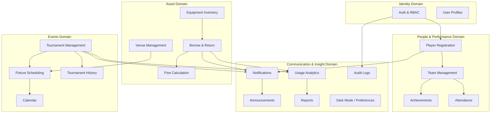
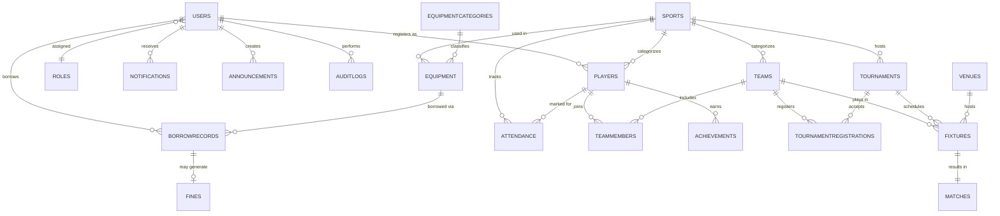
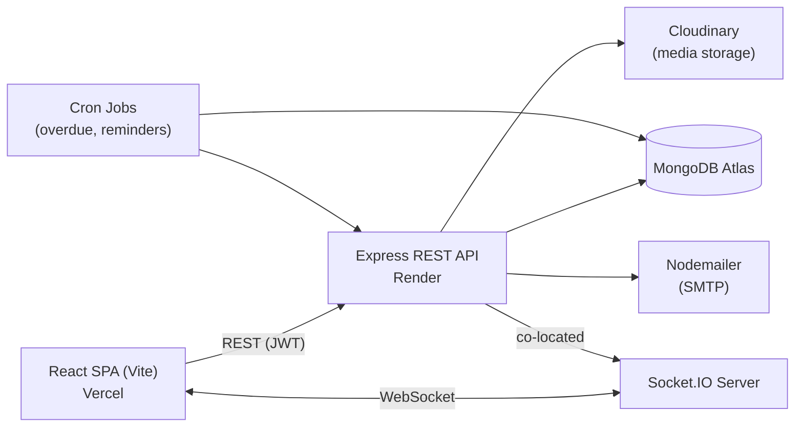
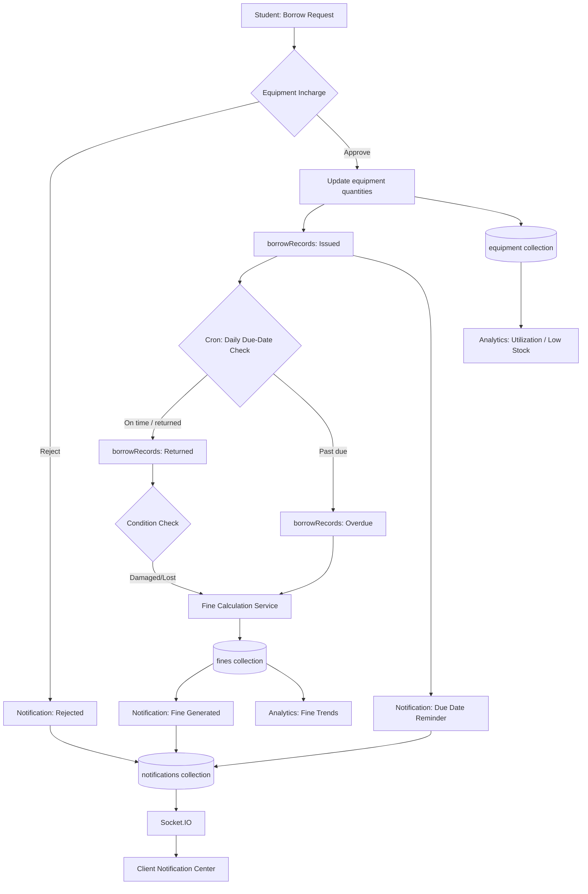
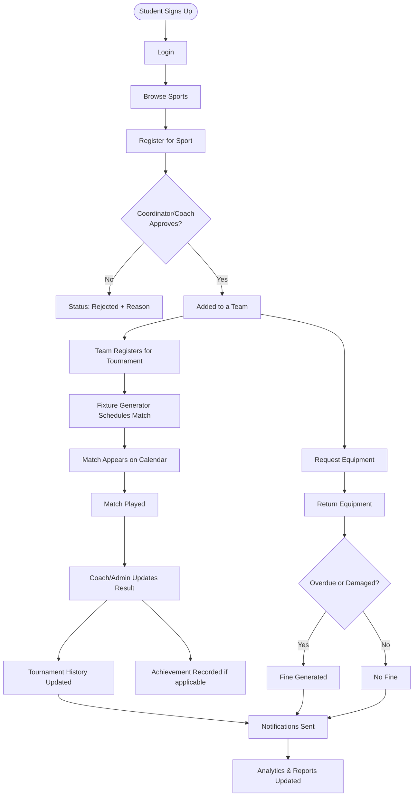
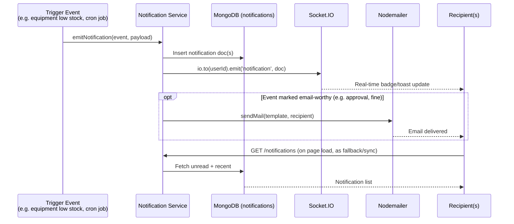
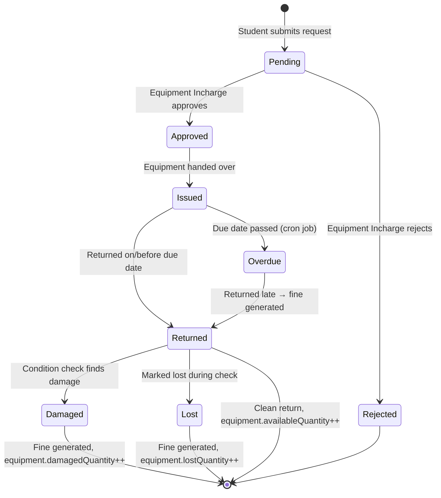
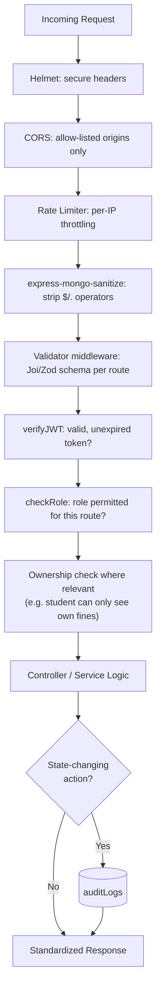
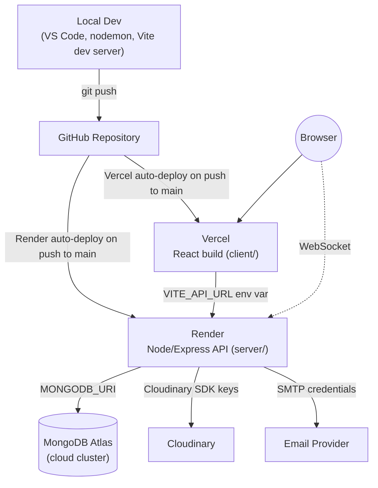

# SportSync — Smart Sports Council Management Hub
## Complete Technical Blueprint (v1.0)

**Team:** Dhivakar E U (Backend/Architecture) · Dharshini P (Frontend/UI-UX)
**Stack:** MongoDB · Express.js · React.js (Vite) · Node.js — MERN
**Status:** Blueprint for review — no implementation code has been written yet, per the staged process requested.

> This document covers Sections 1–25 as requested. Read Section 26 ("Gaps & Clarifications") before approving — it lists decisions that will materially change the schema or APIs if answered differently, so it's worth resolving before Step 3 (project init).

---

## Table of Contents

1. System Overview
2. Functional Requirements
3. Non-Functional Requirements
4. User Roles & Permissions Matrix
5. Complete Module Architecture
6. MongoDB Database Design
7. Mongoose Models
8. API Architecture
9. Frontend Page Architecture
10. Backend Folder Structure
11. Frontend Folder Structure
12. System Architecture Diagram
13. Data Flow Diagram
14. User Flow Diagram
15. Authentication Flow
16. Notification Flow
17. Equipment Borrow/Return Flow
18. Tournament Scheduling Algorithm
19. Fine Calculation Logic
20. Analytics Architecture
21. Security Architecture
22. Development Roadmap
23. Testing Strategy
24. Deployment Architecture
25. Future Enhancement Roadmap
26. Gaps & Clarifications Needed Before Implementation

---

## 1. System Overview

SportSync is a centralized, role-based web platform that runs the full operating cycle of a college Sports Council: player onboarding, team formation, equipment lifecycle, tournament scheduling, venue allocation, attendance, achievements, and the reporting/analytics layer that ties them together.

The system is built as a single MERN monorepo-style project with two deployable units:

- **Client** — a React 18 + Vite SPA, styled with Tailwind CSS and shadcn/ui, talking to the backend exclusively over a versioned REST API plus a Socket.IO channel for live notifications.
- **Server** — a layered Express.js API (routes → controllers → services → models) backed by MongoDB Atlas via Mongoose, with Cloudinary for media and Nodemailer/Socket.IO for outbound communication.

Five roles (Admin, Sports Coordinator, Coach, Equipment Incharge, Student) share one codebase but see entirely different navigation, dashboards, and API permissions — enforced both in the UI (route guarding) and in the API (RBAC middleware), since the brief explicitly requires that URL-guessing cannot bypass authorization.

The system's job, in one sentence: **every physical or organizational event in the sports council — a borrow, a match, a registration, a fine — should update state in one place and automatically ripple into notifications, analytics, and reports**, rather than living in five disconnected spreadsheets.

---

## 2. Functional Requirements

Grouped by module, using `FR-<module>-<n>` IDs so they can be traced into test cases later.

**Auth & RBAC**
- FR-AUTH-1: Users authenticate via email + password; passwords stored as bcrypt hashes only.
- FR-AUTH-2: JWT access tokens are issued on login and validated on every protected request.
- FR-AUTH-3: Every route is annotated with allowed roles; unauthorized access returns 403, not a silent redirect.
- FR-AUTH-4: Forgot-password issues a time-limited reset token via email.
- FR-AUTH-5: Students self-register; staff roles (Coordinator, Coach, Equipment Incharge) are created by Admin only — open self-registration for staff roles is a privilege-escalation risk.

**Player Registration**
- FR-PLAYER-1: A student registers for a sport once; a second registration for the same sport is rejected server-side (not just hidden in the UI).
- FR-PLAYER-2: Registration enters `Pending` and requires Coordinator/Coach approval before the student is eligible for teams or tournaments.
- FR-PLAYER-3: Rejected registrations store a reason, visible to the student.

**Team Management**
- FR-TEAM-1: A team belongs to exactly one sport and one season/year.
- FR-TEAM-2: Only approved players for that sport can be added to a team.
- FR-TEAM-3: A team has exactly one captain at a time; reassigning captain is logged.

**Achievements**
- FR-ACH-1: Achievements can be self-submitted by students (with certificate upload) but enter an unverified state until a Coach/Coordinator/Admin verifies them.
- FR-ACH-2: Verified achievements feed the "Top Achievers" and analytics views; unverified ones do not.

**Equipment & Borrow/Return**
- FR-EQ-1: `availableQuantity` can never go negative and can never exceed `totalQuantity`.
- FR-EQ-2: A borrow request cannot request more than current `availableQuantity`.
- FR-EQ-3: Approving a request atomically decrements `availableQuantity` and increments `issuedQuantity`.
- FR-EQ-4: Returning equipment atomically reverses that, and additionally moves quantity into `damagedQuantity`/`lostQuantity` if the returned condition warrants it.
- FR-EQ-5: A daily background job flags any `Issued` record past its `dueDate` as `Overdue` and generates a fine.

**Fines**
- FR-FINE-1: Fine = overdue days × configurable daily rate; separate flat/percentage rules for Damaged/Lost.
- FR-FINE-2: Fine rates are configurable by Admin/Coordinator, versioned so past fines aren't recalculated retroactively when the rate changes.

**Tournaments & Scheduling**
- FR-TOUR-1: Tournaments support Knockout, League (Round Robin), and Group+Knockout formats.
- FR-TOUR-2: The fixture generator must not schedule a team in two matches at overlapping times, must not double-book a venue, and must respect a configurable minimum rest gap between a team's matches.
- FR-TOUR-3: Generated fixtures are editable manually afterward; manual edits re-run the same conflict validation.
- FR-TOUR-4: Duplicate team registration to the same tournament is rejected server-side.

**Venues**
- FR-VENUE-1: A venue cannot have two overlapping bookings, across tournaments.

**Attendance**
- FR-ATT-1: One attendance record per player/sport/session/date (compound-unique), preventing duplicate marking.

**Notifications**
- FR-NOTIF-1: All listed trigger events (Section 16) create a DB notification and emit a Socket.IO event to the relevant user(s) in real time.
- FR-NOTIF-2: Users can mark individual/all notifications read, and delete them.

**Reports & Analytics**
- FR-REPORT-1: Reports for inventory, borrow history, fines, tournament participation, achievements, and attendance are exportable (PDF/CSV) — see Section 26 for scope caveats.

**Dark Mode**
- FR-UI-1: Theme (light/dark/system) persists per user across sessions.

---

## 3. Non-Functional Requirements

| Category | Requirement |
|---|---|
| Performance | API responses for list endpoints < 500ms at expected scale (~2,000 students, ~50 concurrent). Pagination mandatory on all list endpoints. |
| Scalability | Stateless API (JWT, no server sessions) so it can horizontally scale on Render if needed. Indexes on all frequently-filtered fields (Section 7). |
| Availability | Single-region deployment is acceptable for an academic project; document a manual backup routine for MongoDB Atlas rather than building HA. |
| Security | JWT + bcrypt + RBAC middleware + Helmet + rate limiting + Mongo sanitization, detailed in Section 21. |
| Usability | Role-specific navigation and dashboards; no dead-end or "access denied" pages reachable through normal navigation. |
| Responsiveness | Fully usable at 375px (mobile) through desktop widths using Tailwind breakpoints; no desktop-only screens. |
| Maintainability | Layered backend (route/controller/service/model), no business logic inside React components or inside `server.js`. |
| Auditability | Every state-changing action by staff roles is written to `auditLogs` (Section 13). |
| Data Integrity | Quantity invariants (Section 2, FR-EQ-1) enforced at the service layer, not just the UI. |
| Observability | Centralized Express error handler returning a consistent `{ success, message, error }` shape; server-side logging of 4xx/5xx. |

---

## 4. User Roles & Permissions Matrix

Legend: **F** = Full (create/edit/delete), **A** = Approve/Moderate, **O** = Own records only, **V** = View only, **—** = No access.

| Capability | Admin | Coordinator | Coach | Equip. Incharge | Student |
|---|:---:|:---:|:---:|:---:|:---:|
| Manage users & roles | F | — | — | — | — |
| Manage sports catalog | F | F | — | — | — |
| Manage venues | F | F | — | — | V |
| System/fine-rate configuration | F | F (fine rates only) | — | — | — |
| View audit logs | F | — | — | — | — |
| Approve player registration | F | A | A (own sport) | — | — |
| Register for a sport | — | — | — | — | O (create) |
| Create/manage teams | F | F | O (own team) | — | — |
| Mark attendance | V | V | F (own team) | — | V (own) |
| Submit achievement | F | F | F | — | O (create, unverified) |
| Verify achievement | F | F | F (own players) | — | — |
| Add/edit equipment | F | V | — | F | — |
| Approve borrow requests | F | V | — | F | — |
| Request to borrow equipment | — | — | — | — | O (create) |
| Process returns / condition check | F | V | — | F | — |
| Configure fine rates | F | F | — | — | — |
| Waive a fine | F | F | — | — | — |
| Pay/view own fines | V | V | — | V | O |
| Create tournament | F | F | — | — | — |
| Generate/edit fixtures | F | F | — | — | V |
| Update match results | F | F | O (own team's matches) | — | V |
| Register team for tournament | F | F | O (own team) | — | — |
| Create announcements | F | F | — | — | V |
| View analytics dashboard | F | F | O (own team scope) | O (equipment scope) | — |
| Generate reports | F | F | O (own team) | O (equipment) | — |

This matrix is enforced twice: once in the frontend route guards (`ProtectedRoute` component, Section 9) purely for UX, and once — non-negotiably — in Express middleware (Section 21), since the brief's business rule explicitly says URL-guessing must not bypass it.

---

## 5. Complete Module Architecture

Twenty functional modules, grouped into five domains. Each module maps to one Mongoose model set, one Express route file, and one frontend feature folder (Sections 7–11), keeping the "one concern, one place" rule from the coding guidelines.



Each arrow denotes a **data dependency**, not just a UI link — e.g. Fixture Scheduling (M12) cannot run without confirmed Tournament data (M11) and Venue availability (M10); Fine Calculation (M9) cannot run without a Borrow record (M8) crossing its due date.

---

## 6. MongoDB Database Design

Twenty collections, designed with **selective denormalization**: reference-heavy relational data (users, teams, equipment) stays normalized via `ObjectId` refs; frequently-read-together, rarely-changed data (e.g. a fixture's team names) is safe to `.populate()` at query time rather than duplicated, since read volume here is modest (academic-project scale).



**Design decisions worth flagging:**
- `teamMembers` is a join collection rather than an array field on `teams`, so a player's full membership history across teams/seasons can be queried without scanning every team document.
- `matches` is kept separate from `fixtures` (1:1) so that "schedule" data (date/venue/teams) and "result" data (score/winner/status updates) have different write patterns and different edit permissions (Coordinator schedules; Coach/Admin updates results).
- `fines` references `borrowRecords` rather than embedding, since a fine can later be independently waived/paid without touching the borrow record.
- `roles` is a real collection (not a hardcoded enum) so permission strings can be tuned without a code deploy — see Section 26 for the trade-off this introduces.

---

## 7. Mongoose Models

Field tables below are the contract for Step 4 implementation. `req` = required, `idx` = indexed.

### 7.1 `users`
| Field | Type | req | idx | Notes |
|---|---|:---:|:---:|---|
| name | String | ✓ | | |
| email | String | ✓ | ✓ unique | lowercase, trimmed |
| password | String | ✓ | | bcrypt hash, `select: false` |
| role | ObjectId → roles | ✓ | ✓ | |
| phone | String | | | |
| profilePhoto | String | | | Cloudinary URL |
| department | String | | | |
| year | Number | | | students only |
| registerNumber | String | | ✓ unique, sparse | students only |
| isActive | Boolean | ✓ | | default true |
| lastLogin | Date | | | |
| resetPasswordToken / resetPasswordExpires | String / Date | | | |
| timestamps | | | | createdAt/updatedAt |

### 7.2 `roles`
| Field | Type | req | Notes |
|---|---|:---:|---|
| name | String | ✓ | enum: admin, coordinator, coach, equipment_incharge, student |
| permissions | [String] | | permission keys, e.g. `equipment:write` |
| description | String | | |

### 7.3 `sports`
| name (✓, unique) | category (Team/Individual) | description | icon | isActive | createdBy → users |

### 7.4 `players`
| Field | Type | req | idx | Notes |
|---|---|:---:|:---:|---|
| user | ObjectId → users | ✓ | ✓ | |
| sport | ObjectId → sports | ✓ | ✓ | |
| position | String | | | |
| jerseyNumber | Number | | | |
| documents | [String] | | | Cloudinary URLs |
| status | String | ✓ | | enum: pending, approved, rejected |
| approvedBy | ObjectId → users | | | |
| rejectionReason | String | | | |
| registeredAt | Date | ✓ | | |

**Compound unique index:** `{ user: 1, sport: 1 }` — enforces FR-PLAYER-1 at the DB layer, not just app logic.

### 7.5 `teams`
| name (✓) | sport → sports (✓) | captain → players | coach → users | season/year (String) | isActive |

### 7.6 `teamMembers`
| team → teams (✓) | player → players (✓) | role (captain/vice-captain/member) | joinedAt | isActive |

**Compound unique index:** `{ team: 1, player: 1 }`.

### 7.7 `achievements`
| Field | Type | req | Notes |
|---|---|:---:|---|
| player | ObjectId → players | ✓ | |
| sport | ObjectId → sports | ✓ | |
| title | String | ✓ | |
| competition | String | | |
| level | String | ✓ | enum: Intra College, Inter College, District, State, National, International |
| year | Number | ✓ | indexed |
| position | String | | e.g. "1st", "Participant" |
| medal | String | | enum: Gold, Silver, Bronze, None |
| description | String | | |
| certificate | String | | Cloudinary URL |
| images | [String] | | |
| verifiedBy | ObjectId → users | | |
| status | String | ✓ | enum: pending, verified |

### 7.8 `equipmentCategories`
| name (✓ unique) | sport → sports | description |

### 7.9 `equipment`
| Field | Type | req | Notes |
|---|---|:---:|---|
| equipmentCode | String | ✓ unique | QR-ready identifier |
| name | String | ✓ | indexed (text search) |
| category | ObjectId → equipmentCategories | ✓ | |
| sport | ObjectId → sports | | |
| totalQuantity | Number | ✓ | min 0 |
| availableQuantity | Number | ✓ | min 0 |
| issuedQuantity | Number | ✓ | default 0 |
| damagedQuantity | Number | ✓ | default 0 |
| lostQuantity | Number | ✓ | default 0 |
| condition | String | | enum: New, Good, Fair, Poor |
| purchaseDate / purchaseCost / supplier | Date / Number / String | | |
| minimumStockLevel | Number | ✓ | default 5 |
| isActive | Boolean | ✓ | soft delete |
| addedBy | ObjectId → users | | |

**Invariant (enforced in service layer, Section 2 FR-EQ-1):** `totalQuantity === availableQuantity + issuedQuantity + damagedQuantity + lostQuantity`. `status` (Available/Low Stock/Out of Stock/Damaged/Lost) is a computed virtual, not a stored field, so it can never drift from the quantities.

### 7.10 `borrowRecords`
| Field | Type | req | idx | Notes |
|---|---|:---:|:---:|---|
| borrower | ObjectId → users | ✓ | ✓ | |
| equipment | ObjectId → equipment | ✓ | ✓ | |
| quantity | Number | ✓ | | min 1 |
| requestDate | Date | ✓ | | default now |
| approvedBy | ObjectId → users | | | |
| borrowDate / dueDate | Date | dueDate ✓ | ✓ dueDate | |
| returnDate | Date | | | |
| conditionAtReturn | String | | | enum: Good, Damaged, Lost |
| status | String | ✓ | ✓ | Pending, Approved, Rejected, Issued, Returned, Overdue, Lost, Damaged |
| notes | String | | | |

### 7.11 `fines`
| borrowRecord → borrowRecords (✓) | student → users (✓, idx) | reason (Late Return/Damaged/Lost) | overdueDays | ratePerDay | amount (✓) | status (Unpaid/Paid/Waived) | paidDate | waivedBy → users | waivedReason |

### 7.12 `tournaments`
| name (✓) | sport → sports (✓, idx) | description | format (Knockout/League/Group+Knockout) | startDate/endDate | registrationDeadline | venues [→ venues] | status (idx) | maxTeams | createdBy → users | winner/runnerUp → teams | bestPlayer → players | images [] |

### 7.13 `tournamentRegistrations`
| tournament → tournaments (✓) | team → teams (✓) | registeredBy → users | status (Pending/Approved/Rejected) | registeredAt |

**Compound unique index:** `{ tournament: 1, team: 1 }` — enforces FR-TOUR-4.

### 7.14 `fixtures`
| tournament → tournaments (✓, idx) | round (String) | matchNumber | teamA/teamB → teams | venue → venues (idx) | scheduledDate (idx) | scheduledTime | status (Scheduled/Rescheduled/Completed/Cancelled) | generatedBy (Auto/Manual) |

### 7.15 `matches`
| fixture → fixtures (✓, unique) | teamAScore/teamBScore | winner → teams | status (Scheduled/Ongoing/Completed/Walkover/Cancelled) | updatedBy → users | matchDetails (String) |

### 7.16 `venues`
| name (✓) | type (Ground/Court/Indoor Hall/Outdoor Field) | sportsSuitability [→ sports] | capacity | location | maintenanceStatus (Available/Under Maintenance/Unavailable) | isActive |

### 7.17 `attendance`
| player → players (✓) | sport → sports (✓) | session (String) | date (✓) | status (Present/Absent) | markedBy → users |

**Compound unique index:** `{ player: 1, sport: 1, date: 1, session: 1 }`.

### 7.18 `notifications`
| recipient → users (✓, idx) | type (Inventory/Tournament/Player/Borrow/Announcement/System) | title | message | relatedEntity `{ entityType: String, entityId: ObjectId }` | isRead (✓, idx, default false) | createdAt (idx) |

### 7.19 `announcements`
| title (✓) | description (✓) | targetAudience ([role] or "All") | attachment (Cloudinary URL) | createdBy → users | date | isActive |

### 7.20 `auditLogs`
| user → users (✓, idx) | action (✓, e.g. "DELETE_EQUIPMENT") | module (✓, idx) | description | relatedRecordId (ObjectId) | ipAddress | timestamp (✓, idx, default now) |

---

## 8. API Architecture

**Base URL:** `/api/v1` (versioned from day one — cheap now, painful to retrofit).

**Standard response envelope:**
```json
// Success
{ "success": true, "data": { }, "message": "Optional" }
// Error
{ "success": false, "message": "Human-readable", "error": "ERROR_CODE" }
```

**Pagination (all list endpoints):** query params `?page=1&limit=20&sort=-createdAt`, response includes `{ data: [...], pagination: { page, limit, total, totalPages } }`.

**Auth header:** `Authorization: Bearer <jwt>` on every protected route.

| Route Group | Representative Endpoints | Notes |
|---|---|---|
| `/api/v1/auth` | `POST /register` `POST /login` `POST /logout` `POST /forgot-password` `POST /reset-password/:token` `GET /me` | `/register` restricted to student self-signup (Section 26) |
| `/api/v1/users` | `GET /` `GET /:id` `POST /` `PUT /:id` `DELETE /:id` `PATCH /:id/role` | Admin-only for create/role-change |
| `/api/v1/sports` | `GET /` `POST /` `PUT /:id` `DELETE /:id` | Admin/Coordinator write |
| `/api/v1/players` | `GET /` `GET /:id` `POST /` `PATCH /:id/approve` `PATCH /:id/reject` `GET /me` | approve/reject = Coordinator/Coach |
| `/api/v1/teams` | `GET /` `GET /:id` `POST /` `PUT /:id` `POST /:id/members` `DELETE /:id/members/:playerId` | |
| `/api/v1/achievements` | `GET /` `GET /player/:playerId` `POST /` `PATCH /:id/verify` `GET /stats/top-achievers` | |
| `/api/v1/equipment` | `GET /` `GET /:id` `POST /` `PUT /:id` `DELETE /:id` `GET /low-stock` | Equipment Incharge write |
| `/api/v1/borrow` | `POST /request` `PATCH /:id/approve` `PATCH /:id/reject` `PATCH /:id/issue` `PATCH /:id/return` `GET /my-borrows` `GET /overdue` | |
| `/api/v1/fines` | `GET /` `GET /my-fines` `PATCH /:id/pay` `PATCH /:id/waive` `PUT /config/rates` | rate config = Admin/Coordinator |
| `/api/v1/tournaments` | `GET /` `GET /:id` `POST /` `PUT /:id` `PATCH /:id/status` `POST /:id/register-team` | |
| `/api/v1/fixtures` | `POST /generate/:tournamentId` `GET /tournament/:tournamentId` `PUT /:id` `PATCH /:id/result` | `/generate` runs Section 18 algorithm |
| `/api/v1/venues` | `GET /` `POST /` `PUT /:id` `GET /:id/availability` | |
| `/api/v1/attendance` | `POST /` `POST /bulk` `GET /player/:playerId` `GET /sport/:sportId/session` | |
| `/api/v1/notifications` | `GET /` `PATCH /:id/read` `PATCH /read-all` `DELETE /:id` | |
| `/api/v1/announcements` | `GET /` `POST /` `PUT /:id` `DELETE /:id` | |
| `/api/v1/reports` | `GET /inventory` `GET /borrow-history` `GET /fines` `GET /tournament-participation` `GET /achievements` `GET /attendance` `GET /export/:type` | |
| `/api/v1/analytics` | `GET /dashboard/:role` `GET /equipment` `GET /tournaments` `GET /players` `GET /fines` | |
| `/api/v1/audit-logs` | `GET /` (Admin only) | |

---

## 9. Frontend Page Architecture

Routing uses React Router with a role-aware layout shell. Every route is wrapped in `<ProtectedRoute roles={[...]}>`; an unauthorized visit renders a proper 403 page, not a blank screen (Section 4).

| Route | Page | Roles |
|---|---|---|
| `/login`, `/register`, `/forgot-password` | Auth pages | Public |
| `/dashboard` | Role-specific dashboard (5 variants, Section 6 of brief) | All (content varies) |
| `/players` | Registration list / approval queue | All (scoped) |
| `/players/register` | Registration form | Student |
| `/teams`, `/teams/:id` | Team list / detail | All (scoped) |
| `/achievements` | Achievement cards/timeline | All |
| `/achievements/new` | Submit achievement | Student, Coach |
| `/inventory` | Equipment table (search/filter/sort/paginate) | All (write: Equip. Incharge) |
| `/borrow` | My borrow requests / approval queue | All (scoped) |
| `/tournaments`, `/tournaments/:id` | Tournament list / detail (fixtures, results) | All |
| `/tournaments/new` | Create tournament + fixture generator | Coordinator, Admin |
| `/calendar` | FullCalendar month/week/day | All |
| `/venues` | Venue list + availability | All (write: Coordinator, Admin) |
| `/attendance` | Mark/view attendance | Coach (mark), all (view own) |
| `/notifications` | Notification center | All |
| `/announcements` | Announcement feed | All (write: Coordinator, Admin) |
| `/reports` | Report generation + export | Admin, Coordinator, Equip. Incharge (scoped) |
| `/analytics` | KPI cards + charts | Admin, Coordinator (full); Coach/Equip. Incharge (scoped) |
| `/profile`, `/settings` | Profile + theme preference | All |
| `/audit-logs` | Audit trail | Admin |

**Shared component inventory (feature-agnostic, in `components/`):** `DataTable` (search/filter/sort/paginate baked in), `KpiCard`, `Modal`, `ConfirmDialog`, `Toast`, `Skeleton`, `EmptyState`, `StatusBadge`, `FileUpload` (Cloudinary), `ProtectedRoute`, `ThemeToggle`.

---

## 10. Backend Folder Structure

```
server/
├── config/              # db connection, cloudinary, env validation
├── models/              # 20 Mongoose schemas (Section 7)
├── controllers/         # thin — parse req, call service, shape response
├── services/            # business logic (fine calc, fixture generator, quantity math)
├── routes/              # one file per module, mounted under /api/v1
├── middleware/          # auth.js (JWT verify), rbac.js (role check), errorHandler.js,
│                         # rateLimiter.js, validateRequest.js
├── validators/           # Joi/Zod schemas per module
├── jobs/                # cron: overdueCheck.js, dueDateReminder.js
├── utils/                # apiResponse.js, generateToken.js, auditLogger.js
├── sockets/              # socket.io connection + notification emitter
└── server.js             # composition root only — no business logic here
```

## 11. Frontend Folder Structure

```
client/src/
├── components/           # shared, reusable, presentational
├── features/              # one folder per module: equipment/, tournaments/, borrow/...
│   └── <module>/ { components/, hooks/, api.js, slice.js (if Redux) }
├── pages/                 # route-level compositions of feature components
├── layouts/                # DashboardLayout, AuthLayout
├── routes/                 # route table + ProtectedRoute
├── store/                   # Redux Toolkit store (auth, notifications, theme — global-only state)
├── services/                 # axios instance, interceptors (attach JWT, handle 401)
├── hooks/                     # useAuth, useSocket, useTheme, useDebounce
└── utils/                      # formatters, constants, permission helpers
```

Redux Toolkit is scoped to genuinely global state (auth session, notification count, theme) per the brief's "where global state is required" — module-local UI state (table filters, modal open/close) stays in component state or feature-local hooks to avoid an over-centralized store.

---

## 12. System Architecture Diagram



---

## 13. Data Flow Diagram

Level-1 DFD centered on the borrow → fine → notification → analytics chain, the most stateful path in the system:



---

## 14. User Flow Diagram

The student's end-to-end journey (mirrors Section 23 of the brief):



---

## 15. Authentication Flow

```mermaid
sequenceDiagram
    participant U as User (Browser)
    participant C as React Client
    participant A as Express API
    participant DB as MongoDB

    U->>C: Enter email + password
    C->>A: POST /api/v1/auth/login
    A->>DB: Find user by email
    DB-->>A: User doc (hashed password)
    A->>A: bcrypt.compare(password, hash)
    alt Invalid credentials
        A-->>C: 401 Unauthorized
    else Valid
        A->>A: Sign JWT { userId, role, exp }
        A-->>C: 200 { token, user }
        C->>C: Store token (memory/http-only cookie), redirect to role dashboard
    end

    Note over C,A: On every subsequent request
    C->>A: Request + Authorization: Bearer <token>
    A->>A: verifyJWT middleware
    A->>A: checkRole middleware (RBAC)
    alt Token invalid/expired
        A-->>C: 401 → client redirects to /login
    else Role not permitted
        A-->>C: 403 Forbidden
    else OK
        A->>DB: Perform requested operation
        DB-->>A: Result
        A-->>C: 200 + data
    end
```



---

## 16. Notification Flow



Trigger catalog is exactly the list in the brief's Module 16 (inventory, tournament, player, borrow events) — implemented as named functions in `services/notificationService.js` so each module calls one function (`notifyLowStock()`, `notifyOverdue()`, etc.) rather than writing to the collection directly.

---

## 17. Equipment Borrow/Return Flow



---

## 18. Tournament Scheduling Algorithm

**Inputs:** confirmed team list (from `tournamentRegistrations` with status `Approved`), tournament `format`, list of eligible `venues` (filtered by `sportsSuitability` + `maintenanceStatus: Available`), a scheduling window (`startDate`–`endDate`), a per-day time-slot grid, and a configurable `minimumRestHours` between two matches for the same team.

**Round Robin / League:**
```
generateRoundRobin(teams, venues, window, restHours):
    if teams.length is odd: add "BYE" placeholder
    n = teams.length
    rounds = n - 1
    fixedTeam = teams[0]
    rotating = teams[1:]

    for round in 0..rounds-1:
        pairings = pair(fixedTeam + rotating)   # standard circle method
        for (teamA, teamB) in pairings:
            if teamA == "BYE" or teamB == "BYE": continue
            slot = nextAvailableSlot(window, venues, restHours, teamA, teamB)
            if no slot found: flag CONFLICT, surface to Coordinator for manual placement
            else: createFixture(teamA, teamB, slot.venue, slot.datetime)
        rotate(rotating)   # circle method: rotate all but the fixed team
```

**Knockout:**
```
generateKnockout(teams, venues, window, restHours):
    if teams.length is not a power of 2: assign byes to top N seeds (or random, if no seeding data)
    round = 1
    currentRoundTeams = teams
    while currentRoundTeams.length > 1:
        pairs = sequentialPair(currentRoundTeams)
        for (teamA, teamB) in pairs:
            slot = nextAvailableSlot(window, venues, restHours, teamA, teamB)
            createFixture(teamA, teamB, slot.venue, slot.datetime, round)
        currentRoundTeams = "winners of this round"   # placeholder fixtures;
                                                          # populated once results come in
        round += 1
```

**Group + Knockout** runs Round Robin within each group, then feeds group winners/runners-up into the Knockout generator.

**Conflict-checking core** (`nextAvailableSlot`) — this is where the brief's hard constraints live:
```
nextAvailableSlot(window, venues, restHours, teamA, teamB):
    for each candidate datetime in window's slot grid (chronological):
        for each venue in venues:
            if venueHasOverlap(venue, candidate): continue
            if teamHasOverlap(teamA, candidate) or teamHasOverlap(teamB, candidate): continue
            if hoursSinceLastMatch(teamA, candidate) < restHours: continue
            if hoursSinceLastMatch(teamB, candidate) < restHours: continue
            return { venue, datetime: candidate }
    return null   # no valid slot — surfaced as a scheduling conflict
```

This is a greedy, first-fit algorithm — appropriate for the stated scale (a college tournament, not a professional league) and simple enough to explain in a viva. `venueHasOverlap`/`teamHasOverlap` are simple range-overlap queries against already-created `fixtures` for the tournament (plus that team's fixtures in any other **concurrent** tournament, to satisfy FR-TOUR-2 fully — see Section 26 on whether cross-tournament conflicts are in scope). Manual edits (FR-TOUR-3) re-run just `venueHasOverlap`/`teamHasOverlap`/rest-check against the edited fixture before saving, so a manual change can't silently reintroduce a conflict the algorithm avoided.

**Complexity:** O(rounds × teams × venues × slots) in the worst case — trivial at this scale (tens of teams, single-digit venues). A future enhancement (Section 25) could swap in a constraint-satisfaction/backtracking solver if conflict rates get high with many venues and tight windows.

---

## 19. Fine Calculation Logic

**Late return:**
```
overdueDays = max(0, daysBetween(dueDate, returnDate || today))
fine = overdueDays * currentDailyRate
```

**Damaged / Lost:** flat or percentage-of-purchase-cost rule, configurable per category —
```
if conditionAtReturn == "Damaged": fine = damagedFlatRate  (or  purchaseCost * damagedPercent)
if conditionAtReturn == "Lost":    fine = lostFlatRate      (or  purchaseCost * lostPercent)
```
Damaged/Lost fines can **stack** with a late fine if the item was both overdue and damaged on return — each fine reason produces its own `fines` document referencing the same `borrowRecord`, so the breakdown stays legible in reports.

**Worked example (from the brief):** due date 10 Jul, returned 15 Jul → `overdueDays = 5`; at ₹20/day, `fine = 100`.

**Rate configuration:** stored as its own small `fineConfig`-style document (or a `config` collection) with `dailyLateRate`, `damagedFlatRate`/`damagedPercent`, `lostFlatRate`/`lostPercent`, editable by Admin/Coordinator. Each generated `fines` document snapshots the rate it used (`ratePerDay` field, Section 7.11) so a later rate change never rewrites history.

**Automation:** a daily cron job (`jobs/overdueCheck.js`) queries `borrowRecords` where `status: 'Issued'` and `dueDate < now`, flips them to `Overdue`, and calls the fine service — this is the same job referenced in the Borrow/Return flow (Section 17) and Notification flow (Section 16).

---

## 20. Analytics Architecture

Built on MongoDB's **aggregation pipeline** rather than pulling raw documents into Node for computation — keeps heavy grouping/summing at the database layer.

**Pattern per KPI:** one aggregation pipeline per metric, exposed via `/api/v1/analytics/*`, consumed by Recharts on the frontend.

| Metric | Pipeline sketch |
|---|---|
| Most/least borrowed equipment | `$group` `borrowRecords` by `equipment`, `$sum` quantity, `$sort` |
| Equipment utilization rate | `issuedQuantity / totalQuantity` per equipment, computed at read time |
| Monthly borrowing trend | `$group` by `$dateToString` on `borrowDate`, `$count` |
| Tournament counts by status | `$group` `tournaments` by `status` |
| Participation rate | registered teams ÷ `maxTeams` per tournament |
| Most active players | `$group` `attendance` + `borrowRecords` by `player`, weighted sum |
| Fine trends | `$group` `fines` by month, `$sum` amount, split by `status` |

**Dashboard composition:** each role dashboard (Section 6 of the brief) calls a single `/analytics/dashboard/:role` endpoint that internally fans out to the relevant pipelines and returns one payload — avoids the frontend making 8 separate calls on load.

**Caching:** not required at this scale, but the design leaves room for a short-TTL cache (e.g. in-memory `node-cache`) in front of the heavier pipelines if dashboard load time becomes noticeable — noted as an easy Phase-6 addition, not built by default.

---

## 21. Security Architecture



**Concrete controls:**
- Passwords: bcrypt, cost factor 10–12, never returned in any API response (`select: false` at schema level).
- JWT: short-lived access token; secret in `.env`, never in source control; `httpOnly` cookie or in-memory storage on the client (not `localStorage`, to reduce XSS token theft risk).
- RBAC: centralized `middleware/rbac.js`, route files declare `router.get('/', checkRole(['admin','coordinator']), controller)` — permissions live next to routes, not scattered in controllers.
- Secrets: `.env` + `.env.example` committed (no real values); `dotenv-safe` or manual validation on boot so a missing var fails fast instead of silently.
- Input validation: every mutating route validated against a Joi/Zod schema before hitting the controller.
- Mongo injection: `express-mongo-sanitize` strips `$`/`.` keys from `req.body`/`req.query`/`req.params`.
- XSS: React escapes by default; any `dangerouslySetInnerHTML` usage (none planned) would need explicit sanitization.
- File uploads: Cloudinary with server-side file-type/size validation before the upload call, not just an `accept=""` hint in the `<input>`.
- Ownership checks: role alone isn't sufficient for some routes — e.g. a Student hitting `GET /fines/:id` also needs an ownership check that `fine.student === req.user.id`, or Admin/Coordinator override.

---

## 22. Development Roadmap

| Phase | Scope | Primary Owner | Suggested Duration |
|---|---|---|---|
| 1 | Project setup, Auth, DB connection, RBAC skeleton, base layout/navigation | Dhivakar (backend) / Dharshini (layout) | 1.5–2 weeks |
| 2 | Player Registration, Team Management, Sports catalog | Both | 2 weeks |
| 3 | Equipment Inventory, Borrow/Return, Fine Calculation | Dhivakar (logic) / Dharshini (UI) | 2–2.5 weeks |
| 4 | Tournament Management, Venue Management, Fixture Generator, Calendar | Dhivakar (algorithm) / Dharshini (Calendar UI) | 2.5–3 weeks |
| 5 | Achievements, Attendance, Notifications (Socket.IO), Announcements | Both | 2 weeks |
| 6 | Analytics, Reports, Audit Logs, Dark Mode | Both | 1.5–2 weeks |
| 7 | Testing, bug-fixing, security pass, deployment | Both | 1.5–2 weeks |

Both members implement across the stack for at least one module outside their primary responsibility (e.g. Dharshini takes backend ownership of Notifications; Dhivakar takes frontend ownership of the Analytics charts) so the viva doesn't expose a "frontend person/backend person" split under questioning — matches the brief's explicit requirement that both understand the whole system.

---

## 23. Testing Strategy

**Layers:**
- **Unit** — service-layer logic that has real branching: fine calculation, quantity invariants, fixture conflict-checking. Framework: Jest.
- **Integration** — API endpoints against a test MongoDB instance (in-memory `mongodb-memory-server` or a dedicated test Atlas cluster): auth flows, RBAC enforcement, borrow/return state transitions.
- **Manual/Exploratory** — Postman collections per module, one environment per role (5 pre-authenticated tokens) to manually verify UI + API together before each phase demo.

**RBAC test matrix (example, mirrors the brief):**

| Actor | Action | Expected |
|---|---|---|
| Student | `DELETE /api/v1/equipment/:id` | 403 Forbidden |
| Student | `GET /api/v1/fines/:id` (someone else's) | 403 Forbidden (ownership check) |
| Coach | `POST /api/v1/tournaments` | 403 Forbidden |
| Equipment Incharge | `PATCH /api/v1/borrow/:id/approve` | 200 OK |
| Coordinator | `PATCH /api/v1/players/:id/approve` | 200 OK |
| Unauthenticated | Any `/api/v1/*` protected route | 401 Unauthorized |

**Per-module checklist (repeated for all 20 modules):** valid input · invalid input · missing required fields · duplicate data (where a uniqueness rule exists) · unauthorized role · unauthenticated request · edge cases (e.g. borrowing exactly the last available unit; fixture generation with an odd number of teams; fine calc when return date == due date).

**Postman organization:** one collection per module, environment variables for `{{baseUrl}}` and one token variable per role, so switching "who's calling" is a one-click environment swap.

---

## 24. Deployment Architecture



**Environment separation:** `.env.development` (local) vs. platform-level env vars on Vercel/Render (production) — never a committed `.env` with real values. CORS on the Render API allow-lists only the Vercel production domain (plus `localhost` in dev). Optional (Phase 7 stretch): a basic GitHub Actions workflow running lint + Jest tests on PRs before merge to `main`, so a broken build can't reach Vercel/Render automatically.

---

## 25. Future Enhancement Roadmap

Explicitly out of scope for the Semester 7 deliverable, but the schema/architecture above doesn't block any of these later:

- **QR-code equipment tracking** — `equipmentCode` field already exists for this; add a scan-to-borrow/return flow.
- **Online fine payment** — Razorpay/Stripe integration against the existing `fines.status` field.
- **Native mobile app** — the REST API is already client-agnostic; a React Native or Flutter client could reuse it directly.
- **AI-assisted team balancing** — suggest team composition from historical `attendance`/`achievements` data.
- **Push notifications** — extend the existing notification service with Web Push / FCM alongside Socket.IO.
- **Multi-department / multi-college federation** — would require an `organization`/`college` tenant field threaded through most collections; a bigger schema change, worth deciding on early if there's any chance of this (see Section 26).
- **Live match commentary / streaming embed** on the `matches` detail view.
- **Advanced fixture solver** (constraint satisfaction/backtracking) if manual-conflict rates become high with more venues and tighter windows.

---

## 26. Gaps & Clarifications Needed Before Implementation

Per the requested process ("identify any missing requirements" before Step 3), here's what the brief doesn't pin down — each of these changes the schema, an API contract, or scope, so worth deciding now rather than mid-Phase-3:

1. **Fine payment tracking.** The brief lists a `fines` status but doesn't say whether "Paid" is just an Admin-marked flag (offline payment, e.g. paid at the sports office) or needs a real payment gateway. This blueprint assumes **offline/manual marking** (simplest, no PCI/gateway concerns for an academic project) — flag if online payment is actually required, since that's a Phase-7-sized addition, not a config toggle.
2. **Self-registration scope.** Should Coach/Equipment Incharge accounts ever be self-registered (e.g. with an approval step), or strictly Admin-created? This blueprint assumes **strictly Admin-created for all non-student roles** — open self-registration for staff roles is a privilege-escalation surface worth deciding deliberately, not defaulting into.
3. **Single college vs. multi-department.** Is this one sports council for one institution, or does it need to support multiple departments/colleges with data isolation? Everything above assumes **single institution** — retrofitting a tenant field later touches almost every collection, so better to confirm now if there's any chance of multi-college use (e.g. inter-college tournaments hosted *by* this system rather than just recorded as an achievement level).
4. **Report export scope.** "Export to PDF/CSV where practical" — which reports specifically need PDF (formatted, printable) vs. CSV (raw data dump) is left open. Recommend deciding per-report in Step 4 rather than building a generic exporter for all ten report types up front.
5. **Achievement verification authority conflicts.** If a Coach submits an achievement for their own player, can that same Coach verify it, or does it need Coordinator/Admin sign-off to avoid self-verification? Not specified — recommend requiring verification by someone other than the submitter.
6. **Fine appeals / disputes.** The brief has "waive a fine" (Admin/Coordinator) but no student-facing dispute/appeal flow. Is a simple waive-on-request enough, or is a formal appeal state needed?
7. **Equipment condition grading.** "Condition" is listed as a field (New/Good/Fair/Poor) but there's no defined workflow for *who* assesses it at return time beyond "Equipment Incharge" — is a photo requirement needed for Damaged/Lost claims, given fines are attached?
8. **Rest-time and cross-tournament conflicts.** Section 18's algorithm checks conflicts *within* a tournament by default. If two tournaments can run concurrently and share players/venues, the "no double-booking" rule needs to check across tournaments too — worth confirming whether concurrent tournaments are expected at all.
9. **Notification email thresholds.** Which of the ~15 notification triggers should also fire an email (vs. in-app only)? Emailing on every single event risks spam; this blueprint suggests emailing only on approvals/rejections/fines and leaving reminders in-app + optionally digest, but that's a judgment call worth setting explicitly.
10. **Data retention / academic year rollover.** Do old tournaments, borrow records, and attendance ever get archived, or does everything live in the primary collections indefinitely? Matters for pagination performance and for how "season/year" on `teams` is meant to be used at year-end.
11. **Uploaded file limits.** No max file size/type specified for certificates, profile photos, or announcement attachments — needed for both UX (clear error) and Cloudinary cost/quota control.

None of these block starting Phase 1 (Auth/RBAC/setup) — they mostly affect Phases 3–6. Flagging now so a default assumption baked into the schema in Week 2 doesn't need to be unwound in Week 8.

---

### Status: Awaiting your review

This covers Steps 1–2 of your process. Once you've confirmed the assumptions in Section 26 (or told me to proceed with the defaults stated above), I'll move to **Step 3 — project initialization** (repo scaffold, `.env.example`, base Express + Vite setup, DB connection), and then **Step 4 onward — one module at a time**, starting with Auth & RBAC, each with the 10-point breakdown (purpose → model → endpoints → backend → frontend → components → integration → validation → error handling → tests) you specified.
